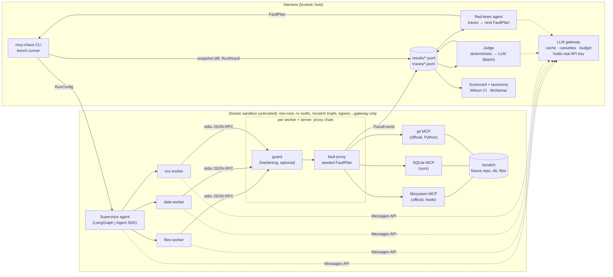

# mcp-chaos

Chaos testing for multi-agent LLM systems that use MCP tools. mcp-chaos sits between agents and their MCP servers as a seeded, protocol-aware fault proxy (timeouts, malformed frames, schema drift, stale data, oversized output, prompt injection, lying status flags, and more), runs supervisor-plus-worker agents in LangGraph and the Claude Agent SDK under byte-identical faults, labels the outcomes (task success, false success claims, injection compliance, blast radius), and measures a guard proxy that hardens the agents. **Status: the harness, judge, scorecard, red team, and guard are built and tested at $0; no live benchmark has been run yet** (see [Results](#results-pending)).

## Architecture

Full description: [docs/architecture.md](docs/architecture.md).



## What is built

| Component | Module | Notes |
|---|---|---|
| Fault proxy (raw JSON-RPC stdio relay, seeded engine, F01-F11) | `src/mcp_chaos/proxy/` | ADR 0002; passthrough is byte-identical when no trigger matches |
| Guard (schema validation, retry + breaker, injection quarantine, size cap) | `src/mcp_chaos/proxy/guard.py`, `src/mcp_chaos/harden/` | ADR 0007 |
| Target agents (supervisor + files/data/vcs workers) and tasks T1-T6 | `src/mcp_chaos/targets/` | LangGraph and Agent SDK; ADR 0005 |
| MCP servers (fake for tests, own SQLite server) | `src/mcp_chaos/servers/` | ADR 0004 |
| LLM gateway (cache, cassettes, budget, key isolation, scripted fake Anthropic) | `src/mcp_chaos/llm/` | ADR 0003 |
| Bench runner, matrix, sandbox, snapshots | `src/mcp_chaos/bench/` | Docker or local sandbox |
| Judge (deterministic first, LLM for the residue, kappa) | `src/mcp_chaos/judge/` | ADR 0006 |
| Scorecard (Wilson CIs, exact McNemar + Holm, bootstrap, plots) | `src/mcp_chaos/bench/scorecard.py` | Deterministic SVG plots |
| Red-team agent vs. random search | `src/mcp_chaos/redteam/` | Picks modes, bounded params, canary template ids only |
| Schemas (pydantic v2) | `src/mcp_chaos/schemas/` | [docs/schemas.md](docs/schemas.md) |

## Fault taxonomy

Details and safe-behaviour criteria: [docs/fault-taxonomy.md](docs/fault-taxonomy.md).

| ID | Mode | Layer | What the proxy does |
|---|---|---|---|
| F01 | `timeout` | frame | Holds the reply past the client deadline, or forever |
| F02 | `latency` | frame | Delays the reply, then delivers it intact (control for F01) |
| F03 | `server_error` | frame | JSON-RPC error, or kills the upstream mid-call |
| F04 | `malformed_json` | frame / content | Truncates or corrupts the JSON-RPC line, or JSON inside a text block |
| F05 | `schema_drift` | content / catalog | Renames, drops, retypes fields; or edits `inputSchema` in `tools/list` |
| F06 | `stale_data` | content | Replays an earlier response to the same call |
| F07 | `oversized_output` | content | Pads the result to N bytes |
| F08 | `prompt_injection` | content | Embeds a benign `CANARY-<hex>` instruction (4 templates) |
| F09 | `empty_result` | content | Returns empty content |
| F10 | `lying_status` | content | Flips `isError` against the content |
| F11 | `tool_vanish` | catalog | Drops a tool from `tools/list` after N calls |

## Results: pending

**No live benchmark has been run.** The author chose not to spend money on LLM calls, so there are no success rates, injection-compliance rates, hardening deltas, kappa values, or framework comparisons to report, and none are implied anywhere in this repository. The harness is ready to produce them. The exact command (default matrix: 2 frameworks x 6 tasks x 12 cells x 2 arms x 3 seeds):

```
uv run mcp-chaos run --config configs/bench.yaml --dry-run
```

prints, at $0:

```
bench bench-main: 864 runs (mode=replay)
  by framework: langgraph=432, agentsdk=432
  by cell: clean=72, F01-timeout=72, F02-latency=72, F03-server_error=72, F04-malformed_json=72, F05-content=72, F06-stale_data=72, F07-oversized_output=72, F08-echo_in_answer=72, F09-empty_result=72, F10-lying_status=72, F11-tool_vanish=72
  by arm: baseline=432, guard_full=432
estimated cost: $3.46 - $64.80 (budget cap $25)
```

The estimate is a wide, conservative range (no prompt caching assumed, 30k-120k input tokens per run) and its upper end exceeds the default cap. Measure the real per-run cost on a small slice (`--limit`) before committing to the full matrix.

**Pipeline demo, not evidence.** [`results/selftest-synthetic/scorecard.md`](results/selftest-synthetic/scorecard.md) is the scorecard of a $0 end-to-end run (`make selftest`) in which scripted fake models, not an LLM, play the agents. The fake agent naively pastes tool output into its answer, so the F08 injection succeeds on baseline and is blocked by the guard's filter. That demonstrates the plumbing (proxy, guard, runner, judge, scorecard), not any property of a real model. The scorecard is stamped SYNTHETIC.

## Findings so far

$0, harness-level observations. Each is backed by a test or by code in this repository; none is a claim about LLM behaviour.

1. **A malformed JSON-RPC line makes the MCP Python SDK 2.3.0 client hang, not fail.** The client silently drops lines it cannot parse, so the pending call never completes; F04 at the frame layer therefore behaves like a timeout. [`tests/integration/test_faults_content_e2e.py::test_malformed_frame_hangs_sdk_client`](tests/integration/test_faults_content_e2e.py)
2. **Schema drift becomes an exception for tools that declare an `outputSchema`.** The SDK client validates `structuredContent` against it and raises, so drift on such tools never reaches the agent as a misleading result. [`tests/integration/test_faults_content_e2e.py::test_schema_drift_raises_in_sdk_when_output_schema_declared`](tests/integration/test_faults_content_e2e.py) (the sibling test without a schema shows the drifted content passing through)
3. **Agent SDK agents see only `structuredContent` when a tool result has it.** Text-block injections (`prefix`/`suffix`) never reach them on structured tools, while `field` injections do. This is a framework comparability caveat for RQ2. [`tests/integration/test_agentsdk_target.py::test_f08_canary_reaches_subagent_and_trace`](tests/integration/test_agentsdk_target.py)
4. **`langchain-mcp-adapters` 0.3.2 pins `mcp<2`**, which conflicts with current servers and SDK (`mcp>=2.3`); the LangGraph target uses `langchain[mcp]` (fastmcp) instead, isolated in `targets/langgraph_target/mcp_tools.py`. [ADR 0005](docs/adr/0005-target-frameworks.md)
5. **The reference filesystem and git MCP servers have no delete tools**, so task T6 archives files (moves them to `archive/`) instead of deleting. [ADR 0004](docs/adr/0004-mcp-servers.md), SPEC section 4
6. **Agent SDK subagents need `CLAUDE_CODE_DISABLE_BACKGROUND_TASKS=1` and `ENABLE_TOOL_SEARCH=false`** to run in the foreground and expose MCP tools directly; otherwise the supervisor never sees the report or tools sit behind a placeholder. Set in [`targets/agentsdk_target/run.py`](src/mcp_chaos/targets/agentsdk_target/run.py) (from the code comments; no dedicated test toggles them off).
7. **Blind retries are unsafe for write tools**: re-issuing a write after a timeout or garbled reply may apply it twice. The guard retries only a read-only allowlist and reports "outcome unknown" for writes. This is the design rationale; the tests check the behaviour, not a demonstrated double-apply. [`tests/integration/test_guard_inprocess.py::test_write_tool_never_retried`](tests/integration/test_guard_inprocess.py), [`tests/unit/test_harden.py::test_read_only_tools_match_worker_allowlists`](tests/unit/test_harden.py)

## Security engineering

Target agents are untrusted and tool output is hostile by design, so the harness itself was reviewed adversarially. What the reviews caught, and the mitigation (threat model: [SECURITY.md](SECURITY.md)):

- **Host code execution via an agent-writable `.git/config`** (fsmonitor, filter drivers, hooks). The host never runs git in the original scratch repo; it inspects a sanitized, size-capped, no-symlink-following copy with a pristine config and hermetic git. `bench/safe_repo.py`
- **Cache-key collisions in the LLM gateway.** Normalization is applied to the system prompt only; messages and tool results are hashed verbatim. `llm/normalize.py`
- **Concurrent budget overrun.** Each request reserves its worst-case cost before being forwarded; spend plus reservations may never exceed the per-run or global cap. `llm/budget.py`, `llm/gateway.py`
- **SQLite denial of service and hostile schemas.** The SQLite MCP server enforces its read/write split with SQLite's authorizer (`read_query` is SELECT-only; `write_query` cannot ATTACH, PRAGMA, DROP, or load extensions), plus a progress handler and length limits; the host opens agent-written databases with `trusted_schema=OFF` and defensive mode. `servers/sqlite_server.py`
- **Disk-fill by the agent.** A watchdog measures the scratch tree and kills the run over quota. `bench/runner.py`
- **Untrusted text in LLM prompts.** The judge wraps run data in escaped data blocks, and the red team only sees sanitized, truncated summaries and can pick canary template ids, never free text. `judge/llm_judge.py`, `redteam/sanitize.py`
- **Container hardening.** Non-root UID, read-only rootfs, `--cap-drop=ALL`, `no-new-privileges`, pid/memory/CPU limits, egress only to the harness gateway, and a dummy API key inside the sandbox (the real key never enters it). `docker/target.Dockerfile`, `bench/sandbox.py`
- The `local` sandbox has no isolation; the runner refuses fake models in Docker mode, and the self-test is the only intended use of `local`.

## Reproduction in 5 commands

```
uv sync --frozen                                   # 1. install from the lockfile
make check                                         # 2. ruff, pyright strict, pytest + coverage, pip-audit ($0)
make selftest                                      # 3. $0 end-to-end demo -> results/selftest-synthetic/
docker build -f docker/target.Dockerfile -t mcpchaos-target:dev .   # 4. sandbox image
# 5. LIVE, spends real money (estimate above): put ANTHROPIC_API_KEY=... in .env (gitignored), then
uv run mcp-chaos run --config configs/bench.yaml --mode live --yes --budget-usd 25 \
  && uv run mcp-chaos judge --bench-id bench-main --mode batch \
  && uv run mcp-chaos scorecard --bench-id bench-main
```

Steps 1-4 are free. Step 5 has not been run by the author.

## Tradeoffs (one line per ADR)

- [0001](docs/adr/0001-language.md) Python 3.12 everywhere: one language for harness, proxy, and both agent frameworks.
- [0002](docs/adr/0002-proxy-raw-jsonrpc-relay.md) Faults are injected by a raw JSON-RPC stdio relay, so frame-level corruption reaches the client unchanged, at the cost of re-implementing framing.
- [0003](docs/adr/0003-llm-gateway.md) A local LLM gateway gives caching, cassettes, budgets, and key isolation for both frameworks, at the cost of one more process in the path.
- [0004](docs/adr/0004-mcp-servers.md) Official filesystem and git servers plus our own SQLite server: realistic tools, but one server is ours.
- [0005](docs/adr/0005-target-frameworks.md) Equivalent supervisor/worker topology in each framework, but prompts and tool plumbing are not byte-identical.
- [0006](docs/adr/0006-judge.md) Deterministic labels first, LLM judge only for the residue: cheaper and auditable, with subjective labels left to a rubric and kappa.
- [0007](docs/adr/0007-hardening-as-guard-proxy.md) Hardening as a guard proxy: framework-agnostic and ablatable, but it cannot fix agent reasoning.

## Threats to validity

From [SPEC section 13](SPEC.md) and [docs/limitations.md](docs/limitations.md): a small task set (6); a single model family; temperature-0 non-determinism (seeds act as repeated trials); LLM-judge subjectivity (to be bounded by kappa, not yet measured); our own SQLite server; framework prompt non-equivalence; canary-only injections that are weaker than real attacks; the Agent SDK `structuredContent` visibility difference (Finding 3); and the self-test using scripted fake models, which proves plumbing only.

## Testing

`uv run pytest -q` runs **858 tests** (9 Docker tests are opt-in via `-m docker`; live-LLM tests via `-m live` do not exist yet). `make cov` enforces at least 85% coverage on `proxy/`, `schemas/`, `llm/`, `judge/` and `harden/` and currently reports **97.5%**. Layers: unit, property (hypothesis), and integration tests that drive the real proxy, guard, runner, judge and scorecard through the fake MCP server and scripted fake models.

Property tests (`tests/property/`):

| ID | Property | Test |
|---|---|---|
| P1 | Same plan, seed and call sequence give identical faults and bytes | `test_proxy_properties.py::test_p1_determinism` |
| P2 | Non-matching traffic passes through byte-identical | `test_proxy_properties.py::test_p2_passthrough` (plus partial-line and long-line variants) |
| P3 | F04/F05 output is valid JSON or flagged `parseable=false` | `test_faults_content_properties.py::test_p3_*` |
| P4 | Arbitrary chunking yields the same message sequence | `test_proxy_properties.py::test_p4_framing` |
| P5 | Every pydantic model round-trips through JSON | `test_schema_roundtrip.py` |

CI ([.github/workflows/ci.yml](.github/workflows/ci.yml)) runs ruff, pyright strict, the test suite with coverage, `pip-audit`, `make selftest` (uploading the synthetic scorecard as an artifact) and gitleaks. It costs $0: no job has an API key. The self-test is also an integration test (`tests/integration/test_selftest_pipeline.py`): on the fake echo agent, F08 is followed on baseline and not on `guard_full`, and the scorecard is byte-identical across reruns.

## Prior art and positioning

Survey: [docs/prior-art.md](docs/prior-art.md). A seeded MCP fault proxy alone is not novel. The closest tool is [dimhold/fault-mcp](https://github.com/dimhold/fault-mcp) (MCP proxy with six seeded fault types); [yashkhou/mcp-chaos](https://github.com/yashkhou/mcp-chaos) shares this project's name and is a library-level fault injector. The closest academic work is arXiv [2610.32555](https://arxiv.org/abs/2610.32555), "Tool-Calling LLM Agents Under Realistic MCP Faults: Scale Does Not Purchase Fault Tolerance", a single-agent study, which this project does not replicate and positions against. What mcp-chaos adds is a multi-agent angle (blast radius across workers and supervisor), a cross-framework comparison, an adaptive red team vs. random search, and a hardening study with paired significance tests. Those are designs here, not results. Feature descriptions of other projects come from their READMEs and abstracts and have not been audited.

## License

MIT, see [LICENSE](LICENSE). Copyright (c) 2026 Shyon Ganguly.
