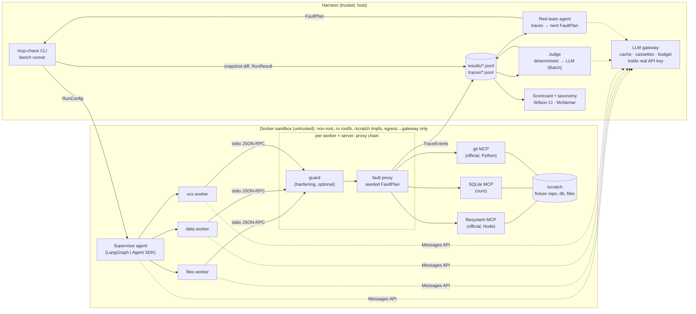

# Architecture

**Data flow of one run:** the runner materializes a fixture into `/scratch`, writes the `FaultPlan`, and starts the container. Each worker's MCP server command is `mcp-chaos proxy --agent <w> --server <s> [--guard cfg] --plan plan.json -- <upstream cmd>`. The agents run the task, the proxy emits `TraceEvent`s, the runner snapshots `/scratch` and diffs it against the fixture, and writes a `RunResult`. The judge labels results in a separate pass. The red team reads labeled results and emits the next `FaultPlan`s.
